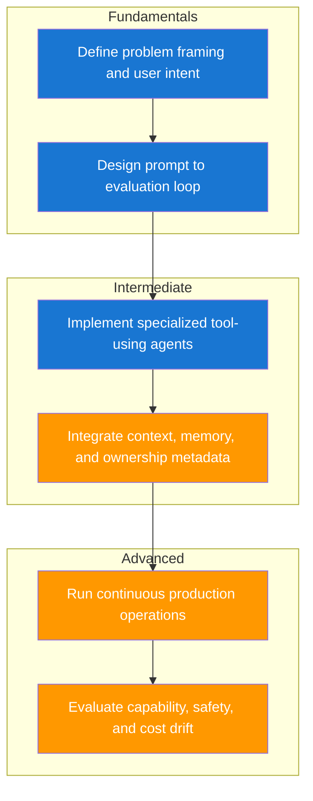

# Security Learning Path for the Role

This page helps you move from broad job expectations to a concrete preparation plan. The path is organized so each stage builds evidence for the next one. By the end, you should have rehearsable system narratives and measurable product outcomes.

## Progression Model

## Weekly Interview Prep Cadence

| Week | Primary Goal | Observable Output |
|---|---|---|
| 1 | Build shared vocabulary and baseline architecture | One-page agent system diagram and glossary review. |
| 2 | Practice retrieval, tool-use, and workflow orchestration | Two scenario walkthroughs with quality and reliability scoring. |
| 3 | Deepen reliability and HITL strategy | Draft of guardrails, failure policies, and on-call signals. |
| 4 | Simulate full interview loop | Timed mock answers and a complete iteration-loop narrative. |

## Interview Focus Signals

??? question "How do you decide where autonomous execution should stop and human review should start?"
  Use a risk tier matrix based on potential blast radius, legal or safety impact, and confidence in task success. High-risk actions require explicit HITL approvals with contextual summaries.

??? question "What makes your agent outputs high signal to partner teams?"
  Outputs include quality evidence, business impact, likely owner, next-step guidance, and verification checks. This keeps tickets actionable and improves trust in agent behavior.

--8<-- "_abbreviations.md"
