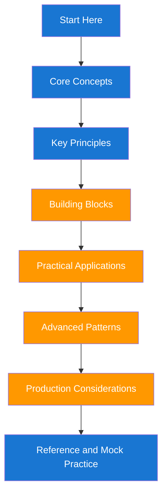

# Getting Started

This guide is designed to mirror the real demands of a Staff or Principal AI and LLM security systems interview. You will build fluency in both model behavior and security-aware production agent design. The best way to use it is as a sequence, not as disconnected notes.

## Prerequisites

| Prerequisite | Why It Matters |
|---|---|
| LLM basics (prompting, context windows, embeddings) | You need a clear mental model of how model behavior changes with context and instructions. |
| Security and platform familiarity | You are expected to connect model behavior to security outcomes and operational constraints. |
| Software engineering proficiency | You are expected to build and operate production systems, not one-off scripts. |
| Incident response and debugging experience | Success depends on recovering quickly from regressions and quality drops. |
| System design interview readiness | You must own architecture, reliability, and guardrail decisions. |

## Key Questions This Guide Answers

| Interview Question Theme | What You Will Learn Here |
|---|---|
| How do you build agents that safely execute real tasks continuously? | Guardrails, approval workflows, and constrained action policies for tools and data access. |
| How do you prove impact beyond demos? | Task success metrics, user experience outcomes, and iteration closure loops. |
| How do you measure progress over time? | Evals, quality metrics, and regression signals. |
| How do you keep autonomous systems debuggable? | Observability patterns, failure recovery, and operator controls. |
| How do you align with security, product, platform, and engineering teams? | Ownership models, handoff contracts, and prioritization cadences. |

## A repeatable study session

1. **Read:** identify the problem, the trust boundaries, and the main trade-off.
2. **Build:** write or sketch the artifact named in the [roadmap](start-here/01-learning-path.md#stage-checkpoints).
3. **Explain:** give a two-minute answer without looking at the page.
4. **Check:** compare your explanation with the lesson prompts and record one gap to revisit.

!!! note "Progress is demonstrated, not just read"
    The task lists are self-review prompts, not saved course progress. Keep your artifacts and notes locally. Quiz answers are stored in your browser and are not a certification of readiness.

## Recommended Reading Path

Follow the [core concepts](agent-concepts/01-core-concepts.md), [key principles](agent-concepts/02-key-principles.md), [building blocks](architecture-and-workflows/01-building-blocks.md), [practical drills](architecture-and-workflows/02-practical-applications.md), [advanced patterns](production-operations/01-advanced-patterns.md), and [production considerations](production-operations/02-production-considerations.md) in order.

## Choose a Track

| Track | Best For | Start Here |
|---|---|---|
| Product LLM Agents | Engineers focused on user-facing quality, iteration speed, and feature outcomes. | [Product LLM Agents Track](start-here/02-product-track.md) |
| Platform LLM Agents | Engineers focused on orchestration, reliability, guardrails, and operational scale. | [Platform LLM Agents Track](start-here/03-platform-track.md) |

## Tips for Best Results

| Tip | How to Apply It |
|---|---|
| Use dark and light mode intentionally | Practice readability in both themes to mirror long interview prep sessions. |
| Use search before re-reading | Look up terms quickly during mock interviews to reduce context switching. |
| Share deep links to sections | Send focused pages to peers for targeted mock feedback. |
| Time-box practice blocks | Alternate between 25-minute reading and 20-minute whiteboarding. |

--8<-- "_abbreviations.md"
