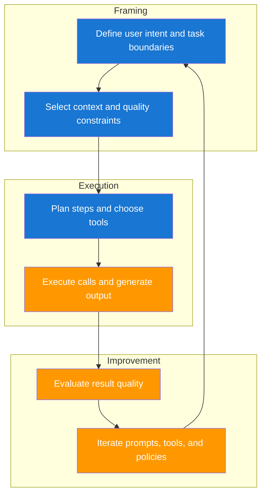

# Security Core Concepts: AI and LLM Agents

At this level, interviewers want to see that you can reason about model behavior and still ship like a platform engineer. The core idea is simple: agents should complete valuable tasks repeatedly, but they must do so safely and produce outcomes teams can trust. This article gives you the vocabulary and control loop you need for that conversation.

## The End-to-End LLM Agent Loop

## Framing vs Execution vs Improvement

| Phase | Main Question | Typical Failure Mode | Staff/Principal Upgrade |
|---|---|---|---|
| Framing | What user outcome should be produced, and under what limits? | Vague goals and missing constraints | Define measurable success and explicit boundaries. |
| Execution | Did the agent choose the right context, tools, and reasoning path? | Fluent but low-utility output | Add structured tool contracts and step-level checks. |
| Improvement | How quickly can the team detect and correct quality regressions? | No feedback loop after deployment | Tie evals to release decisions and ownership. |

## Prioritization Math You Can Explain in Interviews

A practical way to prioritize findings is to score expected impact, not just severity labels.

$$
R = P_s \times I_u \times C_e
$$

| Symbol | Meaning |
|---|---|
| `R` | Priority risk score used for triage ordering. |
| `P_s` | Estimated probability the agent completes the task correctly. |
| `I_u` | User or business impact of that task. |
| `C_e` | Confidence score based on evidence quality and validation checks. |

If one workflow has $P_s=0.7$, $I_u=9$, and $C_e=0.8$, then $R=5.04$. Compare that to another workflow with higher visibility but lower confidence, and you get a stronger prioritization story.

## Interview Signals to Practice

??? question "How would you reduce false positives without reducing coverage?"
  Combine retrieval quality checks with runtime context, then require evidence-backed validation before high-priority escalation. Keep low-confidence outputs in a separate queue for human sampling and label them by workflow and user segment.

??? question "What is your definition of agent success in this domain?"
  Success is a measurable increase in high-quality task completion, faster recovery from regressions, and stable user trust under real production load.

??? question "How do you prevent an agent from causing damage during testing?"
  Enforce least-privilege tool permissions, deny-by-default action policies, and HITL approval gates for risky write operations. Add replayable logs and traces so every high-impact action can be reviewed.

## Practice checkpoint

Sketch the read-only triage assistant from the [roadmap](../start-here/01-learning-path.md). Mark where user intent enters, where retrieved evidence enters, and where a proposed tool call is authorized.

- [ ] I can distinguish retrieved content from trusted instructions.
- [ ] I can name an owner and a measurable success condition for each phase.
- [ ] I can explain why model confidence alone cannot authorize an action.

**Next:** [Safety and evaluation principles](02-key-principles.md).

--8<-- "_abbreviations.md"
