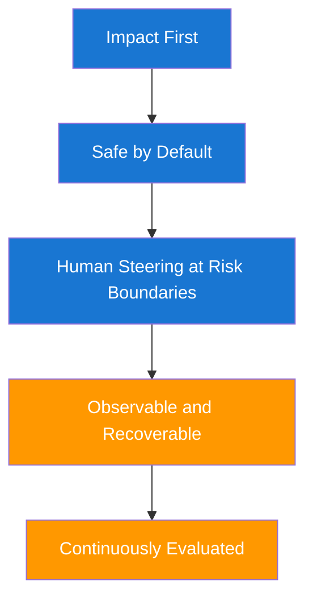

# Security Key Principles for Production LLM Agents

Great demos often fail in production because they optimize for impressive behavior instead of dependable outcomes. In this role, your design choices need to maximize quality, safety, reliability, and delivery speed at the same time. These principles give you a framework for making trade-offs under pressure.

## Principle Stack

## What Each Principle Looks Like in Practice

| Principle | Implementation Pattern | Anti-Pattern to Avoid |
|---|---|---|
| Impact First | Score and rank by user value and business impact. | Shipping outputs that look good but solve low-priority problems. |
| Safe by Default | Policy engine blocks unsafe tools unless explicitly allowed, with least-privilege credentials. | Broad credentials with no execution constraints. |
| Human Steering | Approval queues for dangerous actions and uncertain reasoning. | Full autonomy for high-blast-radius operations. |
| Observable and Recoverable | Traces, action logs, checkpoints, and retry policies with alerting. | Black-box behavior with no replay path. |
| Continuously Evaluated | Task-based evals tied to real user and product outcomes. | Benchmarking only on toy examples. |

## Measuring Reliability and Safety Together

You can frame system quality as a balance between useful action and bounded risk.

$$
Q = \frac{V_t \times S_r}{1 + E_c}
$$

| Symbol | Meaning |
|---|---|
| `Q` | Overall quality indicator for the agent system. |
| `V_t` | Number of validated task outcomes that lead to user value. |
| `S_r` | Safety reliability ratio, such as compliant actions over total risky actions. |
| `E_c` | Critical errors or unsafe escalations requiring intervention. |

If $V_t$ and $S_r$ grow while $E_c$ stays low, your program is improving in a way leadership can trust.

## Interview Signals to Practice

??? question "How would you design HITL so it does not become a bottleneck?"
    Use risk-tier routing: auto-approve low-risk actions, batch medium-risk approvals, and require synchronous review only for high-risk or ambiguous operations. Map tiers to action classes such as read-only retrieval, external API writes, or customer-visible content publication.

??? question "What would you do when model reasoning fails on a complex target?"
    Instrument the run, classify failure mode, and improve scaffolding before changing prompts alone. Typical fixes are better retrieval quality, narrower tool scope, and stronger preconditions on structured outputs.

??? question "How do you convince partner teams your system is worth integrating?"
    Show a pilot with reduced MTTR, improved first-pass task success, and clear owner-ready artifacts. Include concrete before-and-after metrics such as user resolution time, escalation rate, and quality score trends.

## Practice checkpoint

Add three controls to your agent-loop sketch: scoped tool access, an approval boundary, and a regression evaluation gate. For each, state one failure it prevents and one failure it cannot prevent.

<quiz>
Which control should determine whether an agent may execute a high-impact write?

- [ ] The model's confidence in its proposed action
- [x] An external authorization policy with required human approval
- [ ] Instructions found in a retrieved document

Authorization must be enforced outside the model. Retrieved evidence and model confidence are not permission to act.
</quiz>

**Next:** [Architecture and building blocks](../architecture-and-workflows/01-building-blocks.md).

--8<-- "_abbreviations.md"
