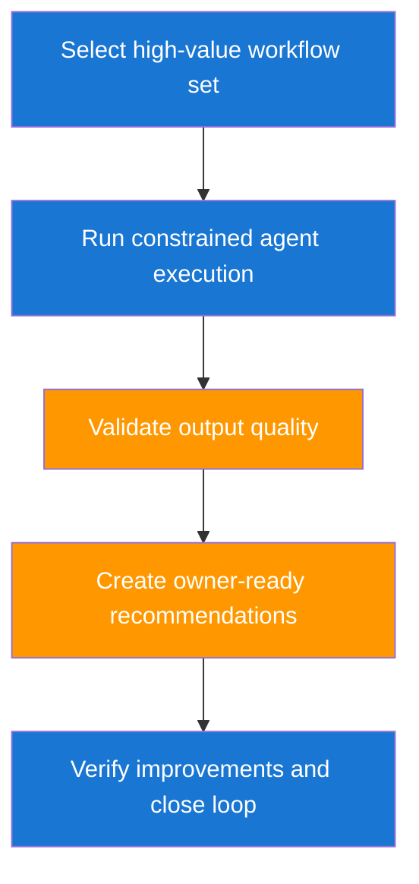

# Practical Security Applications and Scenario Drills

Interviewers often shift from theory to operational scenarios quickly. The strongest answers show not only what you build, but how you constrain execution, communicate uncertainty, and close iteration loops. This section gives you realistic drills so you can practice end-to-end operational narratives.

## Scenario Flow

## Drill Matrix

| Scenario | What to Demonstrate | Evidence to Prepare |
|---|---|---|
| Customer support copilot quality drop | Root-cause path and user-impact estimate | Prompt diff, retrieval trace, and quality score trend. |
| Tool-call failure in workflow automation | Detection, fallback behavior, and safe recovery | Error taxonomy, retry policy evidence, and owner mapping workflow. |
| Hallucination on policy question | Hypothesis testing under safety constraints | Replay traces and confidence scoring notes. |
| Data freshness drift in retrieval | Continuous monitoring and triage strategy | Coverage trend metrics and false-positive controls. |

## Scenario Runbook Template

| Runbook Step | Operator Question | Required Output |
|---|---|---|
| Scope and policy check | Are target workflows and actions allowed right now? | Approved scope record with risk tier. |
| Hypothesis formulation | What failure path is plausible and testable? | One clear hypothesis and stop conditions. |
| Safe execution | Which tools run automatically versus gated? | Policy decisions and action log entries. |
| Evidence packaging | Is quality evidence strong enough for owner action? | Repro steps, impact notes, and confidence value. |
| Iteration verification | Was the improvement deployed and re-tested successfully? | Verification test artifact linked to closure. |

## Decision Trade-off Table

| Decision Point | Option A | Option B | Recommended Use |
|---|---|---|---|
| Test depth | Broad shallow scanning | Narrow deep validation | Start broad, then deepen by risk rank. |
| Approval mode | Full automation | HITL for high risk | Hybrid based on action risk tier. |
| Reporting style | Raw finding stream | Curated owner-ready output | Curated output for faster MTTR. |

## Program Impact Math

One useful way to discuss progress is expected value improvement after an iteration cycle.

$$
V_i = \sum_{j=1}^{m}(P_j \cdot I_j \cdot F_j)
$$

| Symbol | Meaning |
|---|---|
| `V_i` | Expected value improvement after verified iterations. |
| `P_j` | Probability that workflow $j$ occurs in the observed window. |
| `I_j` | Estimated user or business impact for workflow $j$. |
| `F_j` | Improvement effectiveness for workflow $j$ from 0 to 1. |
| `m` | Number of improved workflows in scope. |

This framing helps you explain why a smaller number of high-confidence improvements can outperform a large volume of low-confidence tickets.

??? question "How do you handle partial success during validation?"
    Record the preconditions and confidence level, then classify as conditional quality. This avoids overstating performance while preserving high-value leads.

??? question "How do you prevent duplicate findings across agents?"
    Deduplicate on normalized workflow identifiers plus issue signatures, then merge evidence and preserve source provenance.

??? question "How do you decide when to stop an autonomous drill run?"
    Define stop conditions before execution: policy violation, confidence collapse, or evidence sufficiency reached. This prevents drift into unnecessary risk while preserving useful results.

## Practice checkpoint

Run a tabletop exercise: the triage assistant's finding lookup times out after returning a partial result. Write the user-facing response, the retry decision, and the evidence an operator receives. Use synthetic data; do not execute changes against live systems.

??? success "Review your runbook"
    A strong answer labels the result incomplete, avoids inventing missing evidence, bounds retries, and provides an escalation path. It distinguishes a dependency outage from a denied action and preserves the run identifier for investigation.

**Next:** [Governance and advanced patterns](../production-operations/01-advanced-patterns.md).

--8<-- "_abbreviations.md"
