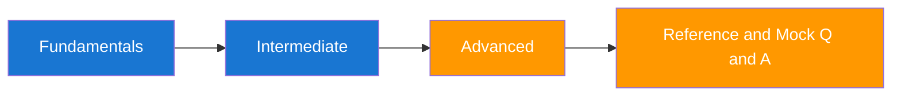

# AI and LLM Security Agent Systems Interview Guide

You are preparing for a role that combines strong AI intuition with security-minded production agent engineering. This guide helps you show both technical depth and systems ownership during Staff and Principal interviews. It turns a broad job description into a practical learning path focused on clear, measurable outcomes.

## Why This Guide Exists

Candidates often understand prompting and model APIs, but struggle to explain how to turn that into dependable multi-component systems with strong safety controls. Interview loops at this level test architecture trade-offs, risk-aware decision-making, and reliability under real constraints. The pages here are structured to help you answer those concerns with concrete designs and language.

## Learning Map by Difficulty

| Section | Focus | Difficulty |
|---|---|---|
| Fundamentals | Agent lifecycle, context handling, and security-aware evaluation loops | 🟢 |
| Intermediate | Tool orchestration, retrieval patterns, and workflow execution | 🟡 |
| Advanced | Operating models, security controls, and scaling strategy | 🔴 |
| Reference | Quick lookup tables, talking points, and interview prompts | 🟢→🔴 |

## Quick Navigation

=== "ML or App Engineer Moving to Staff"
    Start with Fundamentals and map your current feature delivery workflow to the agent loop. Then use Intermediate pages to practice architecture diagrams and trade-off conversations.

=== "Product LLM Agents Track"
    Follow a path that emphasizes user experience quality, evaluation strategy, and iteration velocity. Start at [Product LLM Agents Track](00-introduction/02-product-track.md), then move through Fundamentals and Practical Applications.

=== "Platform LLM Agents Track"
    Follow a path that emphasizes orchestration, reliability, safety controls, and operations at scale. Start at [Platform LLM Agents Track](00-introduction/03-platform-track.md), then focus on Building Blocks and Advanced sections.

=== "Principal Candidate"
    Skim Fundamentals, then focus on Advanced and Reference sections. Prioritize operating model, failure recovery, metrics design, and organization-wide rollout plans.

=== "Interview Week Sprint"
    Use the Cheatsheet and Interview Q and A first. Return to Fundamentals only for weak areas you discover while practicing mock answers.

--8<-- "_abbreviations.md"
