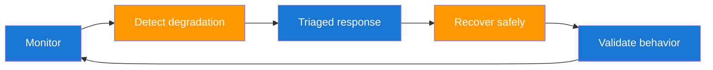

# Production Security Considerations and Operating Model

A production system must keep working even when dependencies fail, models regress, or environments change unexpectedly. In leadership interviews, this is where your operational maturity is tested most directly. This page helps you rehearse how you run the platform day-to-day, not only how you design it.

## Reliability Control Loop

## Production Readiness Checklist

| Domain | Minimum Standard | Verification Signal |
|---|---|---|
| Observability | End-to-end traces plus centralized logs, metrics, and dashboards | Replayable incident timeline and alert audit trail. |
| Resilience | Retries, circuit breakers, and rollback strategy | Controlled chaos test pass rate. |
| Safety | Deny-by-default policy with risk-tier approvals | Zero unauthorized high-risk actions. |
| Governance | Clear ownership, escalation paths, and least-privilege access boundaries | Mean time to assignment trend and access-review completion rate. |
| Change management | Eval gate before rollout | No critical regression after release. |

## Operating Cadence by Horizon

| Cadence | Core Activity | Owner Group | Output Artifact |
|---|---|---|---|
| Daily | Triage high-risk incidents and policy exceptions | Platform operations plus product partner | Prioritized queue with assignment and SLA targets |
| Weekly | Reliability and safety review | Platform engineering plus product leadership | Health dashboard and action register |
| Biweekly | Eval-suite refresh from recent incidents | Applied AI plus partner teams | New or updated scenario eval set |
| Monthly | Autonomy expansion decisions | Principal engineers and governance board | Signed rollout decision with rollback plan |

## SLO Targets for Agent Operations

| SLO Family | Example Target | Why It Matters |
|---|---|---|
| Coverage freshness | Critical assets re-tested within 72 hours | Prevents stale visibility on high-value systems |
| Triage latency | High-risk findings assigned within 4 hours | Reduces exposure window after validation |
| Safety compliance | 99.9% high-risk actions policy compliant | Preserves trust and regulatory posture |
| Recovery speed | Failed runs recovered or quarantined within 30 minutes | Limits cascading operational impact |

## Reliability Ratio

You can summarize operational health with a simple ratio to make leadership updates concrete.

$$
H = \frac{S_u}{S_u + F_c}
$$

| Symbol | Meaning |
|---|---|
| `H` | Operational health ratio over a reporting window. |
| `S_u` | Successful autonomous runs that met policy and quality goals. |
| `F_c` | Critical failures requiring emergency human intervention. |

This ratio should be paired with a volume metric. A high health ratio on a tiny run volume can hide under-testing of critical environments.

??? question "What metrics would you show in a weekly leadership review?"
    Show workflow coverage by priority tier, validated outcomes delivered, MTTR trend, and safety exceptions. Pair those with SLO burn-rate, customer escalation trend, and policy-bypass count, then add one narrative on the largest prevented risk.

??? question "How do you prevent silent failure in continuous autonomous testing?"
    Add heartbeat checks, freshness SLOs for coverage data, and anomaly alerts for sudden drops in output diversity. Implement heartbeat scheduling, route run events through durable queues with dead-letter policies, and alert when freshness or queue-depth thresholds are breached.

??? question "What is your escalation model when a policy bypass is detected?"
    Immediately pause the affected action class, preserve evidence, and invoke incident response with predefined owners. As a containment step, disable implicated credentials and quarantine affected workflows in a restricted execution lane, then resume only after root cause, control patch, and targeted regression eval pass.

## Practice checkpoint

Present a production readiness review for the triage assistant. Include one quality metric, one safety invariant, one recovery objective, alert ownership, and a tested rollback procedure. Treat the example SLO numbers above as discussion starters, not universal requirements.

<quiz>
A canary has a high task-success rate, but an unauthorized action is detected. What should happen next?

- [ ] Expand the canary because the aggregate success rate is high
- [ ] Increase the success-rate target and continue the rollout
- [x] Pause the affected action class, preserve evidence, and invoke the incident process

Aggregate quality cannot cancel an authorization failure. Contain the affected capability and require targeted regression evidence before resuming.
</quiz>

**Next:** use the [concept reference](../interview-toolkit/01-quick-reference.md) and [answer cheatsheet](../interview-toolkit/02-cheatsheet.md), then rehearse the [mock interview questions](../interview-toolkit/03-interview-qa.md).

--8<-- "_abbreviations.md"
