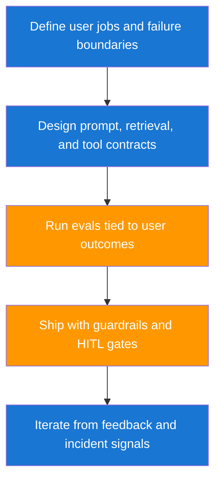

# Product LLM Agents Track

This track is for engineers who want to build AI features that users trust and adopt in security-sensitive environments. It focuses on product outcomes, evaluation quality, and fast iteration loops with risk controls. If your interviews emphasize user value and execution strategy, this is the best starting path.

## Product-Focused Progression

## Recommended Study Sequence

| Stage | Primary Skill | What Good Looks Like |
|---|---|---|
| [Agent concepts](../agent-concepts/01-core-concepts.md) | Translate user intent into measurable agent tasks | You can define success criteria before implementation starts. |
| [Build & practice](../architecture-and-workflows/02-practical-applications.md) | Build workflow scenarios and quality runbooks | You can explain fallback behavior and evidence packaging. |
| [Operate at scale](../production-operations/02-production-considerations.md) | Operate safely with continuous eval gates | You can describe rollout strategy and rollback triggers. |
| [Interview toolkit](../interview-toolkit/03-interview-qa.md) | Communicate trade-offs clearly in interviews | You can answer design questions with concrete metrics. |

## Product Quality Score

A useful planning metric is weighted user outcome quality.

$$
Q_p = \frac{\sum_{i=1}^{n}(w_i \cdot s_i)}{\sum_{i=1}^{n}w_i}
$$

| Symbol | Meaning |
|---|---|
| `Q_p` | Weighted product quality score for an evaluation window. |
| `w_i` | Importance weight for workflow $i$ based on business priority. |
| `s_i` | Quality score for workflow $i$ from 0 to 1. |
| `n` | Number of product workflows in scope. |

If high-priority workflows have weak quality scores, overall user trust will drop even if low-priority workflows perform well.

## Interview Practice Prompts

??? question "How do you decide when an LLM feature is ready to launch?"
    I require a passing eval score on high-priority workflows, stable safety metrics, and clear fallback behavior for low-confidence outputs. I also verify that teams can monitor and recover from failures before full rollout in security-sensitive user journeys.

??? question "How do you balance speed and quality in product delivery?"
    I separate fast iteration from high-risk launches. Low-risk prompt changes can ship quickly behind monitoring, while high-impact changes require stricter eval and review gates.

??? question "How do you prove your agent improves user outcomes?"
    I track task success, escalation rate, and time-to-resolution, then compare those metrics before and after each release. I pair metrics with representative user examples so the impact is both quantitative and explainable.

--8<-- "_abbreviations.md"
