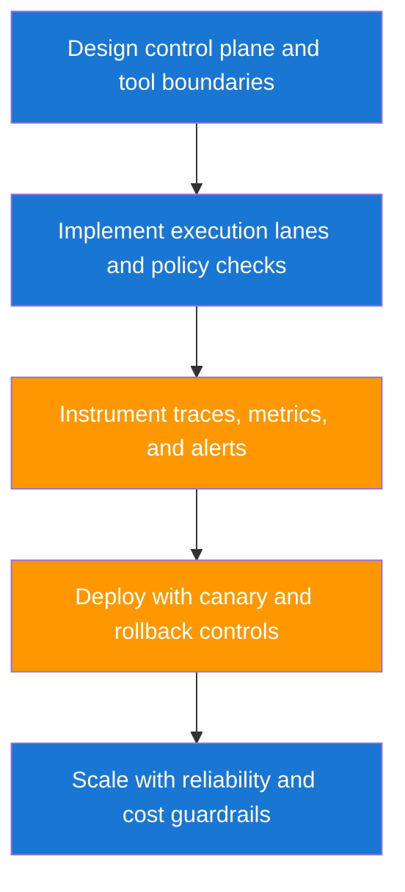

# Platform LLM Agents Track

This track is for engineers who design and operate shared AI infrastructure in security-conscious organizations. It focuses on orchestration, policy enforcement, reliability, and cost-aware scaling. If your interviews emphasize system ownership and production operations, this is the best starting path.

## Platform-Focused Progression

## Recommended Study Sequence

| Stage | Primary Skill | What Good Looks Like |
|---|---|---|
| [Agent concepts](../agent-concepts/01-core-concepts.md) | Define safe execution boundaries and ownership | You can explain who approves what, and why. |
| [Build & practice](../architecture-and-workflows/01-building-blocks.md) | Build robust orchestration and event contracts | You can explain retries, dead-letter handling, and traceability. |
| [Operate at scale](../production-operations/02-production-considerations.md) | Run production operations with SLOs and recovery playbooks | You can describe failure modes and containment strategy. |
| [Interview toolkit](../interview-toolkit/03-interview-qa.md) | Communicate architecture under pressure | You can defend trade-offs with reliability and cost metrics. |

## Reliability-Cost Efficiency Ratio

A useful operational metric balances reliability with operating cost.

$$
E_o = \frac{S_r \cdot T_p}{1 + C_o}
$$

| Symbol | Meaning |
|---|---|
| `E_o` | Operational efficiency score for a reporting period. |
| `S_r` | Safety and reliability compliance ratio from 0 to 1. |
| `T_p` | Throughput of successfully completed workflows. |
| `C_o` | Normalized operating cost index for the same period. |

This ratio helps platform teams avoid over-optimizing throughput at the expense of reliability or cost discipline.

## Interview Practice Prompts

??? question "How do you contain failures in autonomous multi-agent systems?"
    I isolate execution lanes by risk tier, enforce policy checks before tool calls, and apply circuit breakers for repeated failures. I then route incidents to on-call owners with replayable traces for rapid diagnosis and security review.

??? question "What does a strong rollout strategy look like for platform changes?"
    I use shadow runs first, canary exposure second, and full rollout only after eval and observability gates pass. Each stage has explicit rollback conditions and owner accountability.

??? question "How do you prevent platform complexity from slowing delivery?"
    I standardize tool contracts, shared policy libraries, and monitoring templates so teams do not reinvent core controls. This improves reliability while keeping iteration speed high.

--8<-- "_abbreviations.md"
